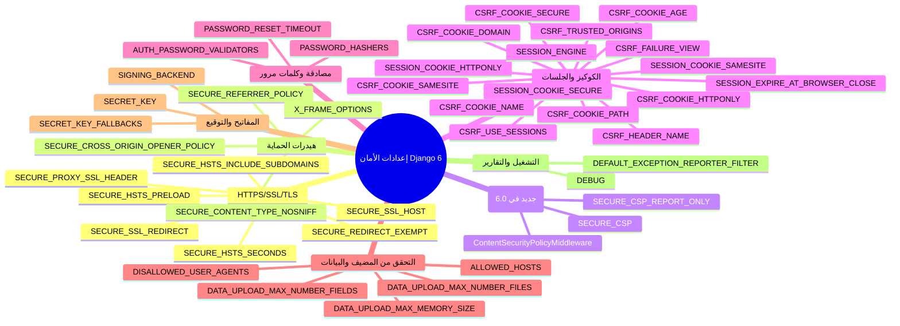

ملاحظة مهمة أولًا: ما أنقله لك أدناه مأخوذ حرفيًا من صفحة الإعدادات الرسمية لإصدار Django 6.0 (توثيق 6.0) مع الترجمة والشرح بالعربية، مع الإشارة إلى ما أُضيف حديثًا في 6.0 مثل دعم CSP【turn23fetch0】【turn27fetch0】.

---

## خريطة سريعة لإعدادات الأمان في جانغو 6



---

## 1) HTTPS / SSL / TLS (تشفير النقل)

### SECURE_SSL_REDIRECT
- الافتراضي: `False`
- ماذا يفعل؟ إذا ضُبط لـ `True`، يقوم `SecurityMiddleware` بإعادة توجيه كل طلبات غير HTTPS إلى HTTPS (ما عدا المسارات المطابقة لقائمة `SECURE_REDIRECT_EXEMPT`).
- لماذا يهم؟ يمنع إرسال البيانات غير المشفّرة، ويقلل هجمات التنصت (Sniffing).
- قيمة الإنتاج الموصى بها: `True`【turn4fetch0】.

### SECURE_PROXY_SSL_HEADER
- الافتراضي: `None`
- ماذا يفعل؟ يعرّف جانغو على الهيدر/القيمة الذي يضعه البروكسي لبيان أن الطلب الأصلي كان آمنًا (HTTPS). يُستخدم لتصحيح قيمة `request.is_secure()` عند التشغيل خلف بروكسي (Nginx/HAProxy/Cloudflare إلخ). غالبًا يُضبط لـ: `("HTTP_X_FORWARDED_PROTO", "https")`.
- تحذير من التوثيق: لا تضبط هذا الإعداد إلا إذا كنت تتحكم في البروكسي وتتأكد أنه:
  - يحذف هيدر `X-Forwarded-Proto` من الطلبات الواردة (من العميل).
  - يضبط هذا الهيدر فقط للطلبات التي أتت فعلًا عبر HTTPS【turn4fetch0】.

### SECURE_SSL_HOST
- الافتراضي: `None`
- ماذا يفعل؟ إذا ضُبط لقيمة نصية مثل `"secure.example.com"`، فكل عمليات إعادة التوجيه إلى SSL ستُوجَّه إلى هذا المضيف بدل المضيف المطلوب أصلاً (مثلاً `www.example.com`). لا أثر له إذا `SECURE_SSL_REDIRECT = False`.
- الاستخدام: مفيد إذا كان نطاق HTTPS مختلفًا عن نطاق HTTP【turn4fetch0】.

### SECURE_HSTS_SECONDS
- الافتراضي: `0`
- ماذا يفعل؟ إذا ضُبط لعدد صحيح غير صفر، يضبط `SecurityMiddleware` هيدر HTTP Strict Transport Security (HSTS) على كل الاستجابات التي لا تحتويه. يُخبر المتصفح باستخدام HTTPS حصريًا لمدة معينة (بالثواني).
- تحذير من التوثيق: ضبط هذا الإعداد بشكل خاطئ قد يعطل الموقع لفترة؛ اقرأ توثيق HSTS أولًا【turn3fetch0】.
- قيمة الإنتاج الموصى بها: `31536000` (سنة) على الأقل.

### SECURE_HSTS_INCLUDE_SUBDOMAINS
- الافتراضي: `False`
- ماذا يفعل؟ إذا `True`، يضيف التوجيه `includeSubDomains` إلى هيدر HSTS (بشرط أن `SECURE_HSTS_SECONDS` ≠ 0). يعني أن السياسة تنطبق على كل النطاقات الفرعية أيضًا【turn3fetch0】.

### SECURE_HSTS_PRELOAD
- الافتراضي: `False`
- ماذا يفعل؟ إذا `True`، يضيف التوجيه `preload` إلى هيدر HSTS (بشرط أن `SECURE_HSTS_SECONDS` ≠ 0). هذا يسمح بإدراج النطاق في قائمة preload الخاصة بالمتصفحات، بحيث لا يمكن الوصول عبر HTTP حتى في أول زيارة【turn3fetch0】.

### SECURE_REDIRECT_EXEMPT
- الافتراضي: `[]`
- ماذا يفعل؟ قائمة بأنماط regex للمسارات التي لا تُحوَّل إلى HTTPS. مفيد إذا كان لديك endpoints معينة لا تستطيع أو لا تريد تشغيلها عبر HTTPS. لا أثر له إذا `SECURE_SSL_REDIRECT = False`【turn4fetch0】.

---

## 2) هيدرات الحماية (Headers)

### SECURE_CONTENT_TYPE_NOSNIFF
- الافتراضي: `True`
- ماذا يفعل؟ يضبط `SecurityMiddleware` هيدر `X-Content-Type-Options: nosniff` على كل الاستجابات التي لا تحتويه. يمنع المتصفح من تخمين نوع المحتوى (MIME sniffing)، فيقلل من احتمال تنفيذ ملف ضار تم تحميله كنوع آخر【turn17fetch1】.

### SECURE_CROSS_ORIGIN_OPENER_POLICY
- الافتراضي: `'same-origin'`
- ماذا يفعل؟ ما لم تضبطه لـ `None`، يضبط `SecurityMiddleware` هيدر Cross-Origin Opener-Policy بالقيمة المعطاة. هذا يقي من هجمات نوع XS-Leaks التي تستغل علاقة النوافذ بين النطاقات【turn17fetch1】.

### SECURE_REFERRER_POLICY
- الافتراضي: `'same-origin'`
- ماذا يفعل؟ يضبط `SecurityMiddleware` هيدر `Referrer-Policy` على الاستجابات بالقيمة المعطاة. يتحكم في كمية المعلومات التي يُرسلها المتصفح في هيدر `Referer` عند التنقل بين الصفحات【turn4fetch0】.

### X_FRAME_OPTIONS
- الافتراضي: `'DENY'`
- ماذا يفعل؟ يحدد قيمة هيدر `X-Frame-Options` الذي يضبطه `XFrameOptionsMiddleware`. يحمي من هجمات Clickjacking بمنع تضمين الصفحة في `<iframe>`. القيم الشائعة: `'DENY'` أو `'SAMEORIGIN'`. التوثيق ينصح عادةً بـ `'DENY'` في الإنتاج【turn7fetch1】.

---

## 3) سياسة أمان المحتوى CSP (جديد في Django 6.0)

### SECURE_CSP
- جديد في 6.0؛ الافتراضي: `{}`
- ماذا يفعل؟ يُستخدمه `ContentSecurityPolicyMiddleware` لضبط هيدر `Content-Security-Policy` على الاستجابات. يسمح بتعريف المصادر الموثوقة لتحميل السكربتات، الأنماط، الصور، الخطوط … إلخ، ويمنع غيرها، مما يقلل XSS وهجمات الحقن【turn17fetch1】【turn27fetch0】.
- مثال من التوثيق (مع ثوابت مساعدة):
  ```python
  from django.utils.csp import CSP
  SECURE_CSP = {
      "default-src": [CSP.SELF],
      "script-src": [CSP.SELF, CSP.NONCE],
      "img-src": [CSP.SELF, "https:"],
  }
  ```
- ملاحظة: التوثيق يذكر أن Django لا يتحقق من صحة التوجيهات/القيم CSP، بل يبني الهيدر فقط؛ يجب عليك التأكد من صحتها【turn17fetch1】.

### SECURE_CSP_REPORT_ONLY
- جديد في 6.0؛ الافتراضي: `{}`
- ماذا يفعل؟ مثل `SECURE_CSP` لكنه يضبط هيدر `Content-Security-Policy-Report-Only` بدلاً من الهيدر القياسي، مما يسمح بمراقبة الانتهاكات ورفع تقاريرها دون حجب المحتوى. مفيد لاختبار السياسات قبل فرضها【turn3fetch0】【turn27fetch0】.

---

## 4) إعدادات كوكيز CSRF (حماية من تزوير الطلبات)

### CSRF_COOKIE_AGE
- الافتراضي: `31449600` (حوالي سنة بالثواني)
- ماذا يفعل؟ عمر كوكيز CSRF بالثواني. طويلة لتجنب مشاكل إغلاق المتصفح أو استخدام الصفحة المخزنة مؤقتًا. يمكن ضبطه لـ `None` لاستخدام كوكيز جلسة (في الذاكرة فقط)【turn6fetch0】.

### CSRF_COOKIE_DOMAIN
- الافتراضي: `None`
- ماذا يفعل؟ النطاق المستخدم عند ضبط كوكيز CSRF. مفيد للسماح بطلبات عبر النطاقات الفرعية، مثل `".example.com"`【turn6fetch0】.

### CSRF_COOKIE_HTTPONLY
- الافتراضي: `False`
- ماذا يفعل؟ إذا `True`، يضع علامة `HttpOnly` على كوكيز CSRF فلا تستطيع جافاسكريبت قراءته. التوثيق يوضح أن هذا لا يوفر فائدة عملية كبيرة ضد CSRF، لكن بعض المراجعين الأمنيين يطلبونه【turn6fetch0】.

### CSRF_COOKIE_NAME
- الافتراضي: `'csrftoken'`
- ماذا يفعل؟ اسم كوكيز CSRF. يجب أن يكون مختلفًا عن أسماء الكوكيز الأخرى في التطبيق【turn6fetch0】.

### CSRF_COOKIE_PATH
- الافتراضي: `'/'`
- ماذا يفعل؟ المسار (Path) الذي يُضبط له كوكيز CSRF. مفيد عند تشغيل عدة مثيلات Django على نفس المضيف باستخدام مسارات مختلفة【turn6fetch0】.

### CSRF_COOKIE_SAMESITE
- الافتراضي: `'Lax'`
- ماذا يفعل؟ يحدد قيمة علامة `SameSite` على كوكيز CSRF، مما يمنع إرسال الكوكيز في الطلبات عبر المواقع (cross‑site) ويقلل هجمات CSRF【turn6fetch0】.

### CSRF_COOKIE_SECURE
- الافتراضي: `False`
- ماذا يفعل؟ إذا `True`، يضع علامة `Secure` على كوكيز CSRF، فلا يُرسل إلا عبر HTTPS【turn6fetch0】.

### CSRF_USE_SESSIONS
- الافتراضي: `False`
- ماذا يفعل؟ يخزن رمز CSRF في جلسة المستخدم بدلًا من كوكيز. يتطلب تفعيل `django.contrib.sessions`. التوثيق يوضح أن تخزين الرمز في كوكيز (السلوك الافتراضي) آمن، لكن بعض المراجعين الأمنيين يفضلون الجلسة【turn6fetch0】.

### CSRF_FAILURE_VIEW
- الافتراضي: `'django.views.csrf.csrf_failure'`
- ماذا يفعل؟ مسار (دوتيد) لدالة العرض التي تُستدعى عند رفض طلب من قِبل حماية CSRF. يمكن تخصيصها لعرض صفحة خطأ مخصصة【turn6fetch0】.

### CSRF_HEADER_NAME
- الافتراضي: `'HTTP_X_CSRFTOKEN'`
- ماذا يفعل؟ اسم هيدر الطلب المستخدم لإرسال رمز CSRF (مثلًا عند إرسال AJAX). العميل يرسل غالبًا `X-XSRF-TOKEN`، فيجب ضبطه لـ `'HTTP_X_XSRF_TOKEN'`【turn7fetch0】.

### CSRF_TRUSTED_ORIGINS
- الافتراضي: `[]`
- ماذا يفعل؟ قائمة بالأصول الموثوقة للطلبات غير الآمنة (مثل `POST`). يتحقق جانغو من هيدر `Origin` أو `Referer` مقابل هذه القائمة. إذا كان التطبيق يرسل طلبات عبر النطاقات، يجب إضافة النطاقات هنا (مع المخطط، مثل `https://sub.example.com`). يدعم البدائل مثل `https://*.example.com`【turn7fetch0】.

---

## 5) إعدادات كوكيز/جلسات SESSION

### SESSION_COOKIE_SECURE
- الافتراضي: `False`
- ماذا يفعل؟ إذا `True`، يضع علامة `Secure` على كوكيز الجلسة فلا يُرسل إلا عبر HTTPS. التوثيق يحذر أن إيقافه يسمح باختطاف الجلسة عبر التنصت【turn9fetch0】.

### SESSION_COOKIE_HTTPONLY
- الافتراضي: `True`
- ماذا يفعل؟ إذا `True`، يضع علامة `HttpOnly` على كوكيز الجلسة فلا تستطيع جافاسكريبت قراءته، مما يصعّب استغلال XSS لاختطاف الجلسة【turn9fetch0】.

### SESSION_COOKIE_SAMESITE
- الافتراضي: `'Lax'`
- ماذا يفعل؟ يحدد قيمة `SameSite` على كوكيز الجلسة: `'Strict'` أو `'Lax'` أو `'None'` أو `False`. يمنع إرسال الكوكيز في بعض السياقات عبر المواقع مما يقلل CSRF وسرقة الجلسة【turn9fetch0】.

### SESSION_ENGINE
- الافتراضي: `'django.contrib.sessions.backends.db'`
- ماذا يفعل؟ يحدد مكان تخزين بيانات الجلسة: قاعدة بيانات، ملفات، كاش، كاش+قاعدة، أو كوكيز مُوقَّعة. اختيار المحرك يؤثر على الأداء والأمان【turn9fetch0】.

### SESSION_EXPIRE_AT_BROWSER_CLOSE
- الافتراضي: `False`
- ماذا يفعل؟ إذا `True`، تنتهي الجلسة عند إغلاق المتصفح (جلسة قصيرة). إذا `False`، تستمر لمدة `SESSION_COOKIE_AGE` (افتراضيًا أسبوعين)【turn9fetch0】.

### SESSION_COOKIE_AGE
- الافتراضي: `1209600` (أسبوعان بالثواني)
- ماذا يفعل؟ عمر كوكيز الجلسة بالثواني. يُستخدم فقط إذا كانت الجلسة مستمرة (ليست منتهية بإغلاق المتصفح)【turn9fetch0】.

---

## 6) إعدادات المصادقة وكلمات المرور

### PASSWORD_HASHERS
- الافتراضي (من التوثيق):
  ```python
  [
      "django.contrib.auth.hashers.PBKDF2PasswordHasher",
      "django.contrib.auth.hashers.PBKDF2SHA1PasswordHasher",
      "django.contrib.auth.hashers.Argon2PasswordHasher",
      "django.contrib.auth.hashers.BCryptSHA256PasswordHasher",
      "django.contrib.auth.hashers.ScryptPasswordHasher",
  ]
  ```
- ماذا يفعل؟ يحدد خوارزميات التجزئة المستخدمة لتخزين كلمات المرور. الافتراضي آمن، ويمكنك إضافة أو إعادة ترتيب الخوارزميات إذا أردت استخدام خوارزمية أقوى كافتراضية (مثل Argon2/BCrypt)【turn11fetch0】.

### AUTH_PASSWORD_VALIDATORS
- الافتراضي: `[]`
- ماذا يفعل؟ قائمة بالمدققات المستخدمة لفحص قوة كلمة المرور عند الإنشاء/التغيير. الافتراضي فارغ (أي تقبل جميع كلمات المرور)، لكن قالب المشروع الافتراضي يضبطها عادةً (UserAttributeSimilarityValidator, MinimumLengthValidator, CommonPasswordValidator, NumericPasswordValidator)【turn11fetch0】.

### PASSWORD_RESET_TIMEOUT
- الافتراضي: `259200` (3 أيام بالثواني)
- ماذا يفعل؟ مدة صلاحية رابط إعادة تعيين كلمة المرور. التوثيق يوضح أن تقليل القيمة لا يمنع brute-force على الرمز، بل يحمي من سيناريوهات مثل الوصول لأرشيف بريد يحتوي روابط قديمة【turn11fetch0】.

---

## 7) التحقق من المضيف والبيانات المُدخلة

### ALLOWED_HOSTS
- الافتراضي: `[]`
- ماذا يفعل؟ قائمة بأسماء المضيف/النطاقات التي يخدمها التطبيق. إجراء أمان ضد هجمات HTTP Host header. يجب ألا تضبطه لـ `*` في الإنتاج. يدعم أحرف البدل مثل `'.example.com'` للنطاقات الفرعية【turn1fetch0】.

### DISALLOWED_USER_AGENTS
- الافتراضي: `[]`
- ماذا يفعل؟ قائمة بأنماط regex لمُعرّفات User-Agent غير المسموح لها بزيارة الموقع (بوتات/زواحف ضارة). يعمل فقط إذا كان `CommonMiddleware` مفعّلًا【turn22fetch0】.

### DATA_UPLOAD_MAX_MEMORY_SIZE
- الافتراضي: `2621440` (2.5 م.ب)
- ماذا يفعل؟ الحد الأقصى لحجم جسم الطلب (بالبايت) قبل رفع `SuspiciousOperation (RequestDataTooBig)`. لا يشمل ملفات الرفع (`request.FILES`). مفيد ضد DoS عن طريق إرهاق الذاكرة【turn13fetch0】.

### DATA_UPLOAD_MAX_NUMBER_FIELDS
- الافتراضي: `1000`
- ماذا يفعل؟ الحد الأقصى لعدد المعاملات (GET/POST) قبل رفع `TooManyFields`. يحمي من هجمات إرسال نماذج ضخمة جدًا لإرهاق المعالجة【turn13fetch0】.

### DATA_UPLOAD_MAX_NUMBER_FILES
- الافتراضي: `100`
- ماذا يفعل؟ الحد الأقصى لعدد الملفات في طلب `multipart/form-data` قبل رفع `TooManyFiles`. يحمي من إرهاق المعالجة والذاكرة بكميات كبيرة من الملفات【turn13fetch0】.

---

## 8) المفاتيح والتوقيع المشفّر

### SECRET_KEY
- الافتراضي: `''` (فارغ)
- ماذا يفعل؟ مفتاح سري مشفر لكل تثبيت Django. يُستخدم في:
  - توقيع الجلسات
  - رسائل Framework (إذا استخدمت CookieStorage/FallbackStorage)
  - رموز إعادة تعيين كلمة المرور
  - أي استخدامات `django.core.signing` ما لم يتم تمرير مفتاح آخر【turn17fetch1】.
- تحذير: يجب أن يبقى سريًا. معرفة المفتاح تمكّن من تزوير الجلسات/الرسائل/الرموز وربما صلاحيات أعلى【turn17fetch1】.

### SECRET_KEY_FALLBACKS
- الافتراضي: `[]`
- ماذا يفعل؟ قائمة مفاتيح احتياطية تسمح بتدوير `SECRET_KEY` دون إبطال الجلسات/الرموز فورًا. عند التدوير، انقل المفتاح القديم إلى بداية القائمة، ثم احذفه بعد فترة مناسبة【turn17fetch1】.

### SIGNING_BACKEND
- الافتراضي: `'django.core.signing.TimestampSigner'`
- ماذا يفعل؟ Backend التوقيع المستخدم لتوقيع الكوكيز وغيرها من البيانات. يؤثر على أمان صلاحية التوقيع والطوابع الزمنية【turn19fetch0】.

---

## 9) إعدادات التشغيل والتقارير (ذات علاقة بالأمان)

### DEBUG
- الافتراضي: `False`
- ماذا يفعل؟ يفعّل وضع التصحيح. التوثيق ينصح بوضعه `False` في الإنتاج أصلًا؛ فإذا كان `True` يعرض Django تفاصيل خطأ كاملة (Stack Trace، إعدادات، مسارات ملفات). حتى لو أخفى جانغو بعض الإعدادات الحساسة (ما تحتوي على KEY/SECRET/PASS/TOKEN)، فإن التفاصيل الأخرى كافية للمهاجم【turn17fetch0】.

### DEFAULT_EXCEPTION_REPORTER_FILTER
- الافتراضي: `'django.views.debug.SafeExceptionReporterFilter'`
- ماذا يفعل؟ الفلتر الافتراضي لتقارير الاستثناءات (يُستخدم في رسائل الخطأ/البريد). يُخفي بعض القيم الحساسة في التقارير. يمكن استخدامه لتقوية ما يُرسل للمطورين/المراقبة【turn17fetch0】.

---

## 10) وسطاء الحماية (Middlewares) الذين يستخدمون هذه الإعدادات

من توثيق Middleware في 6.0:
- `SecurityMiddleware`: يتعامل مع:
  - SSL Redirect (`SECURE_SSL_REDIRECT`)
  - HSTS (`SECURE_HSTS_SECONDS`, `SECURE_HSTS_INCLUDE_SUBDOMAINS`, `SECURE_HSTS_PRELOAD`)
  - `Referrer-Policy` (`SECURE_REFERRER_POLICY`)
  - `Cross-Origin-Opener-Policy` (`SECURE_CROSS_ORIGIN_OPENER_POLICY`)
  - `X-Content-Type-Options: nosniff` (`SECURE_CONTENT_TYPE_NOSNIFF`)【turn26find0】【turn27fetch0】.
- `XFrameOptionsMiddleware`: يضبط `X-Frame-Options` حسب `X_FRAME_OPTIONS`【turn27fetch0】.
- `ContentSecurityPolicyMiddleware` (جديد في 6.0): يضبط `Content-Security-Policy`/`Content-Security-Policy-Report-Only` حسب `SECURE_CSP`/`SECURE_CSP_REPORT_ONLY`【turn27fetch0】.

---

## 11) ملاحظات عملية (من التوثيق نفسه)

- لا تضع أبدًا `DEBUG = True` في الإنتاج【turn17fetch0】.
- لا تستخدم `ALLOWED_HOSTS = ['*']` في الإنتاج【turn1fetch0】.
- لا تضبط `SECURE_PROXY_SSL_HEADER` إلا إذا تحققت من شروط البروكسي (حذف الهيدر من الطلبات الواردة، ضبطه فقط لطلبات HTTPS الأصلية)【turn4fetch0】.
- استخدم `CSRF_TRUSTED_ORIGINS` مع المخطط (مثل `https://example.com`)، ولا تعوّضه بقيم `ALLOWED_HOSTS` فقط.
- عند ضبط HSTS ابدأ بقيم صغيرة واطلع على توثيق HSTS أولًا، لأن الإعدادات الخاطئة قد تعطل الموقع لفترة طويلة【turn3fetch0】.
- في 6.0، صار لديك دعم مدمج لـ CSP عبر `SECURE_CSP`/`SECURE_CSP_REPORT_ONLY` مع `ContentSecurityPolicyMiddleware`؛ ابدأ بـ `SECURE_CSP_REPORT_ONLY` لاختبار السياسة ثم انتقل للفرض【turn23fetch0】【turn27fetch0】.

---

### مراجع
- صفحة Settings في توثيق Django 6.0 (الجزء الأمني والأجزاء ذات الصلة)【turn1fetch0】【turn3fetch0】【turn4fetch0】【turn6fetch0】【turn7fetch0】【turn7fetch1】【turn9fetch0】【turn11fetch0】【turn13fetch0】【turn17fetch0】【turn17fetch1】【turn19fetch0】【turn22fetch0】.
- صفحة Middleware في توثيق Django 6.0 (شرح SecurityMiddleware و XFrameOptionsMiddleware و ContentSecurityPolicyMiddleware)【turn25fetch0】【turn26find0】【turn27fetch0】.
- ملاحظات إصدار Django 6.0 (إضافة دعم CSP)【turn23fetch0】.